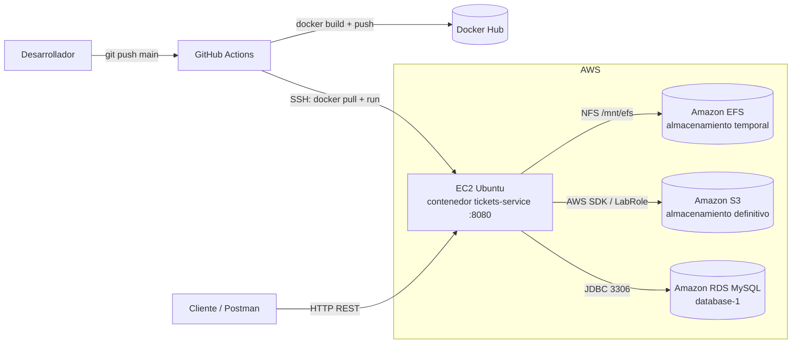

# Tickets Service

Microservicio Spring Boot para un **Sistema de Gestión de Reservas de Eventos con Tickets**. Genera un ticket en PDF por cada reserva, lo guarda temporalmente en **Amazon EFS**, lo sube a **Amazon S3** organizado por evento y usuario, y expone una API REST para administrarlos. Se despliega automáticamente en **EC2** con **GitHub Actions** y **Docker Hub** en cada push a `main`.

> Actividad sumativa grupal "Construyendo y desplegando una solución Cloud Native" — Desarrollo Cloud Native (CDY2204), Duoc UC.

**Integrante: Angel Araya González

---

## Índice

1. [Arquitectura](#arquitectura)
2. [Tecnologías](#tecnologías)
3. [Estructura del proyecto](#estructura-del-proyecto)
4. [Modelo de datos](#modelo-de-datos)
5. [Almacenamiento de los PDF](#almacenamiento-de-los-pdf)
6. [Endpoints](#endpoints)
7. [Configuración](#configuración)
8. [Ejecución local](#ejecución-local)
9. [Despliegue automatizado (CI/CD)](#despliegue-automatizado-cicd)
10. [Infraestructura en AWS](#infraestructura-en-aws)

---

## Arquitectura



**Flujo al generar un ticket:**

1. El cliente envía `POST /api/tickets` con evento, usuario y precio.
2. El ticket se guarda en RDS para obtener su id.
3. Se genera el PDF en el EFS: `/{eventoId}/{usuarioId}/ticket-000001.pdf`.
4. El PDF se sube automáticamente a S3 con la misma estructura.
5. Las rutas de EFS y S3 quedan registradas en la base de datos.

Al **modificar** un ticket, el PDF se regenera y se reemplaza en S3. Al **descargarlo**, se obtiene desde S3. Al **eliminarlo**, se borra de S3, del EFS y de la base de datos.

---

## Tecnologías

| Componente | Tecnología |
|---|---|
| Lenguaje | Java 21 |
| Framework | Spring Boot 4.1 (Web MVC, Data JPA, Validation) |
| Base de datos | MySQL en Amazon RDS |
| Generación de PDF | OpenPDF 1.3 |
| Almacenamiento | Amazon EFS (temporal) y Amazon S3 (definitivo), AWS SDK for Java v2 |
| Contenedor | Docker (imagen multi-stage) |
| CI/CD | GitHub Actions + Docker Hub |
| Cómputo | Amazon EC2 (Ubuntu) |
| Utilidades | Lombok |

---

## Estructura del proyecto

```
tickets-service/
├── .github/workflows/deploy.yml   # Pipeline CI/CD
├── Dockerfile                     # Imagen multi-stage (Maven -> JRE 21)
├── pom.xml
└── src/main/
    ├── java/cl/duoc/tickets_service/
    │   ├── TicketsServiceApplication.java
    │   ├── config/S3Config.java              # Cliente de S3
    │   ├── controller/TicketController.java  # Endpoints REST
    │   ├── dto/                              # Objetos de entrada y salida
    │   │   ├── TicketRequest.java
    │   │   ├── TicketUpdateRequest.java
    │   │   └── EstadisticasEventoResponse.java
    │   ├── exception/TicketNotFoundException.java  # Respuesta 404
    │   ├── model/Ticket.java                 # Entidad JPA
    │   ├── repository/TicketRepository.java  # Consultas a la base de datos
    │   └── service/
    │       ├── TicketService.java            # Lógica de negocio y PDF
    │       └── S3Service.java                # Operaciones con S3
    └── resources/application.properties
```

---

## Modelo de datos

Tabla `tickets`:

| Campo | Tipo | Descripción |
|---|---|---|
| `id` | Long | Identificador autoincremental |
| `eventoId` | String | Evento al que pertenece (obligatorio) |
| `usuarioId` | String | Usuario dueño del ticket (obligatorio) |
| `precio` | Double | Precio del ticket |
| `estado` | String | `RESERVADO` (por defecto), `VENDIDO` o `CANCELADO` |
| `fechaCreacion` | LocalDateTime | Se asigna automáticamente al crear |
| `nombreArchivo` | String | Nombre del PDF, por ejemplo `ticket-000001.pdf` |
| `rutaEfs` | String | Ruta del PDF en el EFS |
| `rutaS3` | String | Clave del PDF en el bucket de S3 |

---

## Almacenamiento de los PDF

Los PDF usan la misma organización por **evento** y **usuario** en ambos almacenamientos:

```
EFS  (/mnt/efs/tickets en la EC2)        S3  (bucket)
└── evento123/                           └── evento123/
    ├── usuarioX/                            ├── usuarioX/
    │   └── ticket-000001.pdf                │   └── ticket-000001.pdf
    └── usuarioY/                            └── usuarioY/
        └── ticket-000002.pdf                    └── ticket-000002.pdf
```

- **EFS** es el almacenamiento temporal donde se genera el archivo. Lo comparten las instancias y persiste aunque se reemplace el contenedor.
- **S3** es el almacenamiento definitivo, desde donde se descargan los tickets.

---

## Endpoints

URL base: `http://<IP_EC2>:8080/api/tickets`

| Método | Ruta | Descripción | Respuesta |
|---|---|---|---|
| `POST` | `/` | Genera un ticket, crea su PDF en EFS y lo sube a S3 | 201 |
| `POST` | `/{id}/subir` | Sube (o vuelve a subir) a S3 el PDF de un ticket | 200 |
| `GET` | `/{id}` | Obtiene un ticket | 200 / 404 |
| `GET` | `/{id}/descargar` | Descarga el PDF desde S3 | 200 / 404 |
| `GET` | `/evento/{eventoId}` | Lista los tickets de un evento | 200 |
| `GET` | `/usuario/{usuarioId}` | Lista los tickets de un usuario | 200 |
| `GET` | `/historial` | Historial con filtros opcionales | 200 |
| `GET` | `/estadisticas` | Estadísticas de todos los eventos | 200 |
| `GET` | `/evento/{eventoId}/estadisticas` | Estadísticas de un evento | 200 |
| `PUT` | `/{id}` | Modifica precio y/o estado; regenera el PDF y lo reemplaza en S3 | 200 / 404 |
| `DELETE` | `/{id}` | Elimina el ticket de S3, EFS y la base de datos | 204 / 404 |

Si los datos enviados no son válidos, la API responde **400 Bad Request**.

### Generar un ticket

```http
POST /api/tickets
Content-Type: application/json

{
  "eventoId": "evento123",
  "usuarioId": "usuarioX",
  "precio": 15000
}
```

Validaciones: `eventoId` y `usuarioId` son obligatorios y solo admiten letras, números, `-` y `_`. `precio` es obligatorio y debe ser mayor a 0.

Respuesta `201 Created`:

```json
{
  "id": 1,
  "eventoId": "evento123",
  "usuarioId": "usuarioX",
  "nombreArchivo": "ticket-000001.pdf",
  "rutaEfs": "/app/efs/evento123/usuarioX/ticket-000001.pdf",
  "rutaS3": "evento123/usuarioX/ticket-000001.pdf",
  "precio": 15000.0,
  "estado": "RESERVADO",
  "fechaCreacion": "2026-11-09T10:30:00"
}
```

### Modificar un ticket

Ambos campos son opcionales; solo se cambian los que se envían.

```http
PUT /api/tickets/1
Content-Type: application/json

{
  "estado": "VENDIDO",
  "precio": 18000
}
```

### Historial con filtros

Todos los filtros son opcionales y combinables. Las fechas van en formato `yyyy-MM-dd` y son inclusivas. Los resultados vienen del más reciente al más antiguo.

```http
GET /api/tickets/historial?eventoId=evento123&usuarioId=usuarioX&estado=VENDIDO&desde=2026-11-01&hasta=2026-11-30
```

### Estadísticas por evento

```http
GET /api/tickets/evento/evento123/estadisticas
```

```json
{
  "eventoId": "evento123",
  "totalTickets": 5,
  "reservados": 2,
  "vendidos": 2,
  "cancelados": 1,
  "montoVendido": 33000.0,
  "montoReservado": 30000.0
}
```

`GET /api/tickets/estadisticas` devuelve una lista con este mismo formato, una entrada por evento.

---

## Configuración

La aplicación se configura con variables de entorno. Las credenciales nunca se guardan en el código.

| Variable | Descripción | Ejemplo |
|---|---|---|
| `DB_URL` | URL JDBC de la base de datos | `jdbc:mysql://<endpoint-rds>:3306/ticketsdb?createDatabaseIfNotExist=true&useSSL=false&allowPublicKeyRetrieval=true&serverTimezone=UTC` |
| `DB_USER` | Usuario de la base de datos | `admin` |
| `DB_PASSWORD` | Contraseña de la base de datos | — |
| `AWS_S3_BUCKET` | Nombre del bucket de S3 | `tickets-duoc-xxxx` |
| `AWS_REGION` | Región de AWS (opcional) | `us-east-1` (por defecto) |
| `EFS_PATH` | Carpeta donde se generan los PDF (opcional) | `/app/efs` (por defecto `./efs-local/tickets`) |

**Credenciales de AWS:** el SDK usa su cadena de credenciales por defecto. En la EC2 las obtiene del rol IAM de la instancia (**LabRole**). En local se pueden usar las variables `AWS_ACCESS_KEY_ID`, `AWS_SECRET_ACCESS_KEY` y `AWS_SESSION_TOKEN`.

---

## Ejecución local

Requisitos: Java 21, una base de datos MySQL accesible y un bucket de S3.

```powershell
# Windows PowerShell
$env:DB_URL="jdbc:mysql://localhost:3306/ticketsdb?createDatabaseIfNotExist=true&useSSL=false&allowPublicKeyRetrieval=true&serverTimezone=UTC"
$env:DB_USER="root"
$env:DB_PASSWORD="..."
$env:AWS_S3_BUCKET="..."
$env:AWS_ACCESS_KEY_ID="..."
$env:AWS_SECRET_ACCESS_KEY="..."
$env:AWS_SESSION_TOKEN="..."

.\mvnw.cmd spring-boot:run
```

La API queda en `http://localhost:8080/api/tickets`. En local, los PDF se generan en la carpeta `efs-local/` del proyecto.

---

## Despliegue automatizado (CI/CD)

El workflow [`.github/workflows/deploy.yml`](.github/workflows/deploy.yml) se ejecuta en cada push a `main` (o manualmente desde la pestaña *Actions*):

1. **build-and-push:** construye la imagen con el [`Dockerfile`](Dockerfile) y la publica en Docker Hub con las etiquetas `latest` y el hash del commit.
2. **deploy:** se conecta por SSH a la EC2, descarga la imagen nueva, reemplaza el contenedor `tickets-service` y limpia las imágenes antiguas.

El contenedor se levanta con:

- Puerto `8080` expuesto.
- El EFS (`/mnt/efs/tickets`) montado en `/app/efs`.
- `--restart unless-stopped`, para que vuelva a iniciar si la EC2 se reinicia.

**Secrets requeridos** en *Settings → Secrets and variables → Actions*:

| Secret | Descripción |
|---|---|
| `DOCKERHUB_USERNAME` | Usuario de Docker Hub |
| `DOCKERHUB_TOKEN` | Token de acceso de Docker Hub (Read & Write) |
| `EC2_HOST` | IP pública de la EC2 |
| `EC2_SSH_KEY` | Llave privada `.pem` de la EC2 |
| `DB_URL`, `DB_USER`, `DB_PASSWORD` | Conexión a RDS |
| `AWS_S3_BUCKET` | Nombre del bucket |

---

## Infraestructura en AWS

| Recurso | Configuración |
|---|---|
| **EC2** | Ubuntu con Docker. Rol IAM **LabRole**. Límite de saltos de metadatos (IMDS) = 2, para que el contenedor pueda usar el rol. |
| **EFS** | En la misma VPC que la EC2, montado en `/mnt/efs` (persistente vía `/etc/fstab`). |
| **S3** | Bucket privado (acceso público bloqueado) en `us-east-1`. |
| **RDS** | MySQL (`database-1`). |

**Security groups:**

| Destino | Puerto | Origen |
|---|---|---|
| EC2 | 22 (SSH) | GitHub Actions / administración |
| EC2 | 8080 (API) | Clientes |
| EFS | 2049 (NFS) | Security group de la EC2 |
| RDS | 3306 (MySQL) | Security group de la EC2 |

**Montaje del EFS en la EC2:**

```bash
sudo apt update && sudo apt install -y docker.io nfs-common
sudo usermod -aG docker ubuntu
sudo mkdir -p /mnt/efs
sudo mount -t nfs4 -o nfsvers=4.1 <ID_EFS>.efs.us-east-1.amazonaws.com:/ /mnt/efs
echo "<ID_EFS>.efs.us-east-1.amazonaws.com:/ /mnt/efs nfs4 nfsvers=4.1,_netdev 0 0" | sudo tee -a /etc/fstab
sudo mkdir -p /mnt/efs/tickets
```
